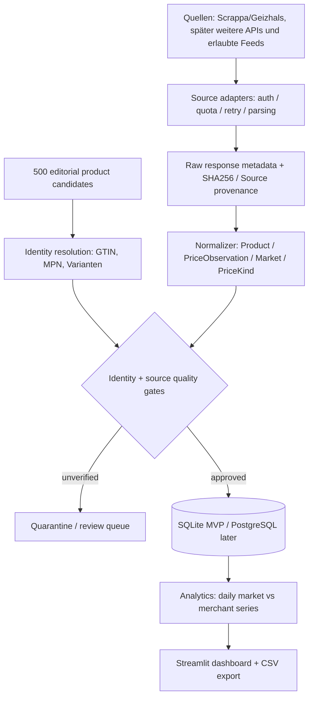

# Zielarchitektur / Betriebsmodell

## 1. Zweck und Grenzen

Das System beobachtet **identische** Handelsartikel in DE und später weiteren EU-Märkten, vergleicht historische Referenzpreise mit aktuellen **lieferbaren Endpreisen** und markiert Aussagen mit Evidenzstatus. Es ist weder ein Bestseller-Register noch ein Beweis für künstlich hochgesetzte Preise. Es gibt keine erfundenen Normalpreise. Die 500 Kandidaten sind nicht verifiziert.

## 2. Systemkontext

## 3. Module (Ist und Soll)

| Modul | Zuständigkeit | Stand |
|---|---|---|
| `src/scrappa_client.py` | HTTP-Client, env key, Scrappa-Suche & Historie | IST, Mock-Tests |
| `src/scrappa_ingest.py` | Kandidaten und historische Marktbestpreis-Punkte | IST, keine Preisfreigabe |
| `scrappa_cli.py` | CLI für Suche, Mapping-Prüfung, Historie, Status, Widerruf | IST, audit/revoke erweitert |
| `src/core.py` | Konservative Preisbewertung nur auf freigegebenen Endpreisen | IST, Unit-Tests |
| `src/review.py` | Freigabe von `price_observations` mit Review-Events | IST, spezifische Gates |
| `src/coverage.py` | Bericht über verifizierte Beobachtungen | IST; Geizhals separat |
| `src/providers/contract.py` | Datenquellen-Adaptervertrag | NEU (nur Vertrag, keine Integrationen) |
| Orchestrator + Job Queue | Rate limits, Retry, Schedules, Fehlerbudgets | SOLL |
| Raw evidence store | Versionierte API-Antworten (lokal, lizenzkonform) | SOLL |
| Cross-source product matcher | GTIN/MPN mit manueller Review | SOLL |
| Postgres + object storage | Skalierung / Team-Betrieb | SOLL |

## 4. Datenfluss und Datenhoheit

1. **Discovery:** Suchergebnisse speichern sich als Kandidaten, nicht als bestätigte Produkte.
2. **Identity:** `manufacturer + MPN + GTIN + variant + size` abgleichen. Bei unklarer Zuordnung `UNVERIFIED`. Explizite Review-Events, jederzeit widerrufbar.
3. **Raw:** Rohantwort mit SHA-256 und Abrufzeit sichern, soweit vertraglich zulässig. API-Key nie protokollieren.
4. **Normalize:** Preisart (Marktbestpreis vs Händlerangebot), MwSt/Versand, Land, Währung, Verfügbarkeit und Beobachtungszeit getrennt erfassen. Informationen, die die API nicht liefert, bleiben `UNKNOWN`.
5. **Validate:** Normalisierte Beobachtungen nur bei belegter Identität und bekanntem Endpreis mit Genehmigung in `approved_comparable_prices`.
6. **Analyze:** Händler-Zeitreihen und Marktbestpreisreihen dürfen **nicht** in denselben historischen Median gemischt werden. Im aktuellen Code wird `geizhals_history` nie in die freigegebene Preis-View übernommen.
7. **Explain:** Zahlen nur mit Quellen, Zeitintervall, Markt, Grundgesamtheit und Konfidenz anzeigen.

## 5. Logische Entitäten

- `products`: redaktionelle Kandidaten; `gtin`, `mpn`, `exact_model`, Identitätsstatus.
- `geizhals_candidates`: Geizhals-ID, Titel, Kandidaten-GTINs, Mappingstatus.
- `geizhals_history`: Marktbestpreis-Historie, Zeitstempel, Cent, `source_kind`, Hash, separater Identitätsstatus.
- `sources`: Provider + Zugriffsmethode + Rechteklärung.
- `merchants`, `listings`: marktspezifische Angebote / Identitätsnachweise.
- `price_observations`: Einzelpreise inkl. Versand-, Lieferbarkeit-, Prüfung-, Währungs-, Länder-Felder.
- `review_events`: unveränderlich anzulegende Entscheidungen (bestehender Code erlaubt noch keine DB-Härtung gegen Updates).
- `demand_signals`: *Proxies* statt behaupteter realer Nachfrage.
- `import_batches`: Herkunft, Hash und Importstatistik.

**Ziel-Erweiterung (Migration, nicht implementiert):** `provider_accounts`, `provider_jobs`, `raw_evidence`, `product_identifiers`, `provider_mappings`, `observations` mit Quellenvertrags-/Lizenzversion, `quality_flags`, `publication_permissions`, `reviewer_id`, `effective_at` und `revoked_at`.

## 6. Infrastruktur / GitHub

MVP: macOS/Linux, Python 3.12/3.13, SQLite im lokalen Projektverzeichnis (in `.gitignore`), Streamlit, `unittest`, GitHub Actions. CI hat **keinen Scrappa-Key**, nutzt ausschließlich Fixtures/Mocks. In GitHub nur Code, Schema, ADRs, redaktioneller Katalog und Testfixtures. Keine realen API-Antworten, keine Schlüssel, keine lokale Datenbank. Kein Push von Kundendaten.

## 7. Grenzen der Kennzahlen

- `daily_market_best`: Geizhals-Markthistorie; Endpreis kann ungeklärt sein.
- `daily_merchant_price`: Händlerangebote; bekannte Versandkosten und Länderbedingungen erforderlich.
- `90_day_reference`: Median verifizierter täglicher Vergleichspreise im 90-Tage-Fenster, Mindestabdeckung und Lückenbericht.
- `seller_30_day_low`: rechtliche Referenz kann nur aus der Händlerhistorie je Angebot ermittelt werden; **nicht** aus Marktbestpreisen ableiten.
- `discount_pct = (reference - delivered_offer) / reference * 100`; Ausweis nur, wenn `reference > 0`, Einheit/Kondition/Markt konsistent.
- Nachfrage-Proxies gesondert ausweisen und nie als gemessenen Absatz titulieren.

## 8. Nicht-Ziele in MVP

Kein Umgehen von Paywalls, Rate Limits oder Robotersperren, kein Scraping ohne Rechteklärung, keine automatische Produktfreigabe allein anhand LLM-Ähnlichkeit, keine veröffentlichten historisch verifizierten Deals ohne Versandprüfung, kein 500-Artikel-Scoring aus 20 Pilotdaten.
